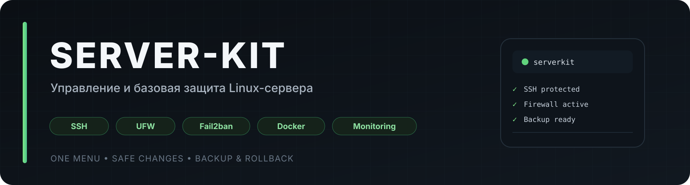
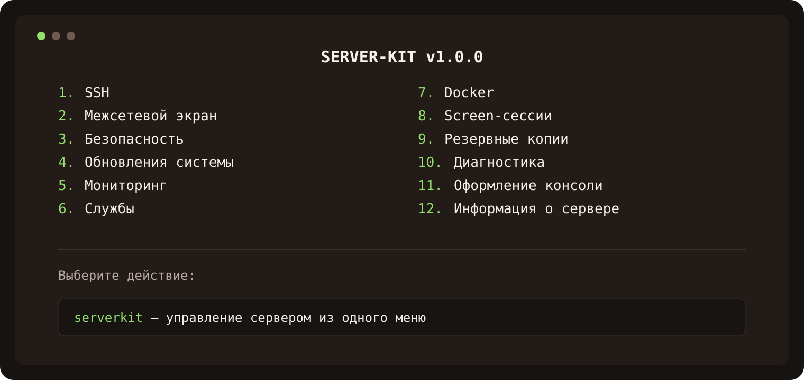

<div align="center">



**Управление и базовая защита Linux-сервера одной командой**

[](https://github.com/GolubiatnikovRoman/server-kit)
[](https://ubuntu.com/)
[](https://www.debian.org/)
[](https://github.com/GolubiatnikovRoman/server-kit/stargazers)
[](https://github.com/GolubiatnikovRoman/server-kit/commits)
[](LICENSE)

</div>

---

> [!WARNING]
> **SERVER-KIT изменяет системные настройки сервера.** Перед изменением SSH, firewall и других критичных компонентов
> создаются резервные копии и выполняются проверки, но доступ к VPS всегда нужно проверять вручную.

**SERVER-KIT** — русскоязычный набор инструментов для администрирования Ubuntu и Debian VPS.
Он объединяет настройку SSH, UFW, Fail2ban, Docker, Screen, мониторинг, резервные копии и диагностику
в одном меню. После установки достаточно команды `serverkit`.

<div align="center">

</div>

## Возможности

- 🔐 **SSH.** Безопасная двухэтапная смена порта, проверка `sshd -t`, отключение входа по паролю только при наличии SSH-ключа, настройка `PermitRootLogin` и rollback.
- 🧱 **UFW.** Установка по подтверждению, безопасное включение, управление портами, IP и правилами.
- 🛡️ **Fail2ban и защита.** Защита SSH, просмотр блокировок, разблокировка IP и автоматические security-обновления.
- 🔄 **Обновления системы.** `apt update`, upgrade/full-upgrade, проверка необходимости перезагрузки.
- 📊 **Мониторинг.** CPU, RAM, Swap, диски, процессы, сеть, порты, соединения, `btop` и `htop`.
- ⚙️ **Службы.** Управление systemd: запуск, остановка, restart, автозапуск и журналы.
- 🐳 **Docker.** Установка только после подтверждения, управление контейнерами, логами, stats, images и Compose.
- 🖥️ **Screen.** Создание, подключение, переподключение и завершение сессий.
- 💾 **Резервные копии.** Backup SSH, UFW, Fail2ban и системных настроек.
- 🩺 **Диагностика.** Проверка SSH, DNS, HTTPS, дисков, служб, портов и базовых проблем безопасности.
- ✨ **Консоль.** Динамический MOTD с основной информацией о сервере.
- ⬆️ **Обновление SERVER-KIT.** Проверка версии и обновление через GitHub Releases.

## Что понадобится

- VPS или сервер с **Ubuntu** или **Debian**
- доступ **root** по SSH
- рабочее подключение к интернету

## Установка

Подключитесь к серверу и выполните:

```bash
bash <(curl -fsSL https://raw.githubusercontent.com/GolubiatnikovRoman/server-kit/main/install.sh)
```

После установки:

```bash
serverkit
```

> [!TIP]
> Повторно запускать установочную команду не нужно — дальнейшее управление выполняется через `serverkit`.

## Безопасная смена SSH-порта

SERVER-KIT не закрывает старый SSH-порт сразу.

1. создаёт резервную копию `/etc/ssh`;
2. проверяет новый порт;
3. при активном UFW разрешает его;
4. временно оставляет старый и новый порты одновременно;
5. проверяет конфигурацию через `sshd -t`;
6. просит проверить новое SSH-соединение во втором терминале;
7. только после подтверждения отключает старый порт.

Пример:

```bash
ssh root@SERVER_IP -p 42137
```

> [!IMPORTANT]
> Не закрывайте текущую SSH-сессию до успешной проверки нового порта.

> [!NOTE]
> Если у хостинг-провайдера используется отдельный firewall / security group, новый порт нужно разрешить и там вручную.

## Docker

Если Docker не установлен, SERVER-KIT только предложит его установку.

```text
Docker не установлен.

1. Установить Docker
0. Назад
```

Установка начнётся только после подтверждения пользователя.

> [!CAUTION]
> Опубликованные Docker-порты требуют отдельного контроля firewall. Наличие UFW само по себе не гарантирует ограничение всех портов Docker.

## Поддерживаемые системы

- **Ubuntu**
- **Debian**

Docker устанавливается из официального APT-репозитория Docker.

## Удаление

```bash
serverkit uninstall
```

Удаление SERVER-KIT не удаляет Docker, UFW, Fail2ban и уже применённые системные настройки.

## Лицензия

[MIT](LICENSE)
